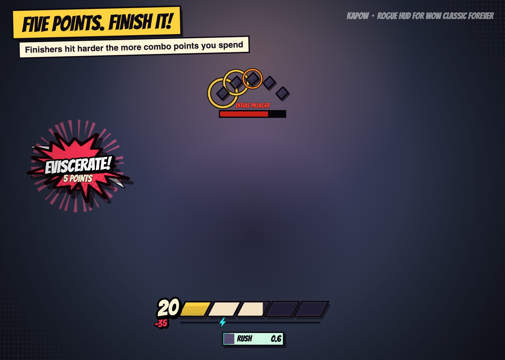
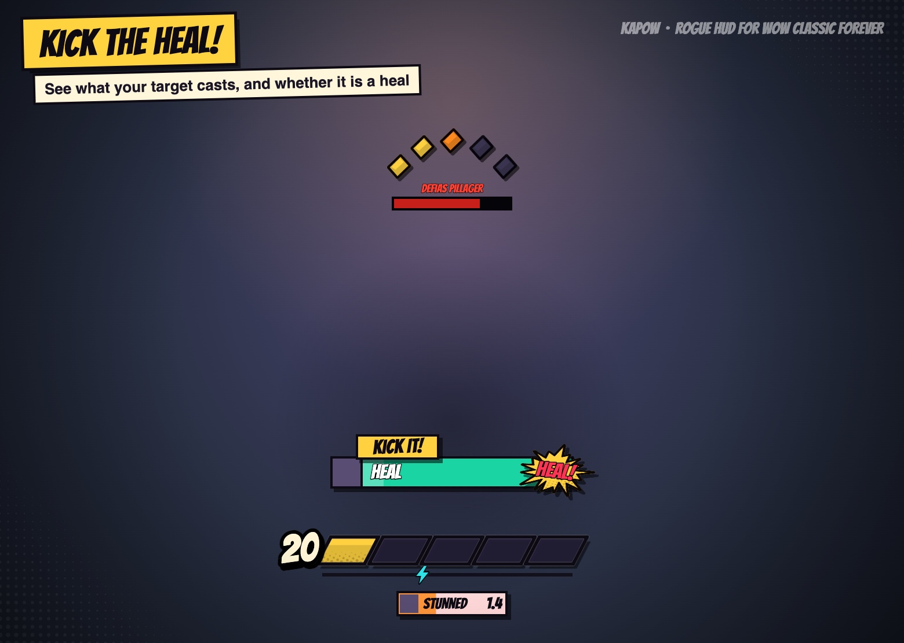
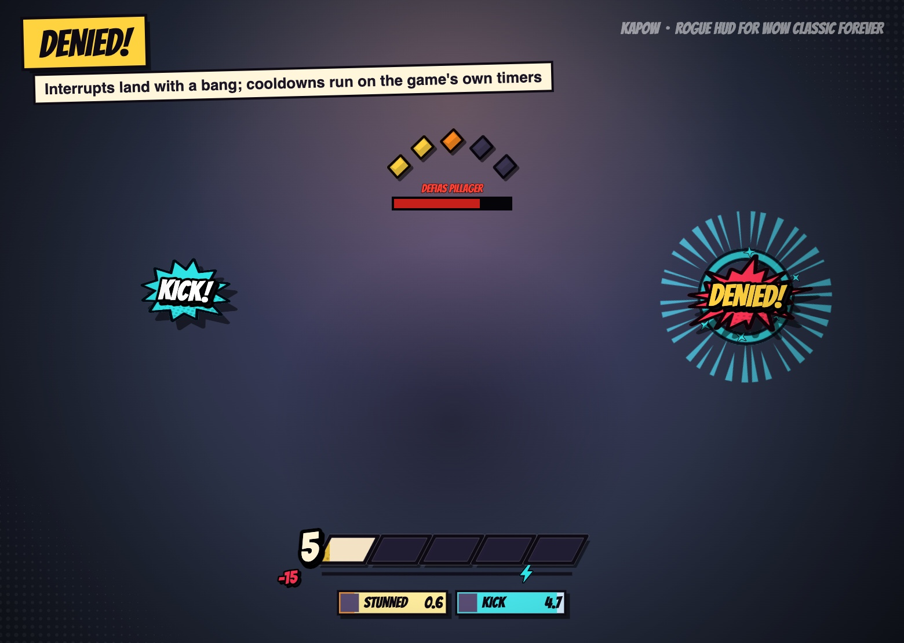
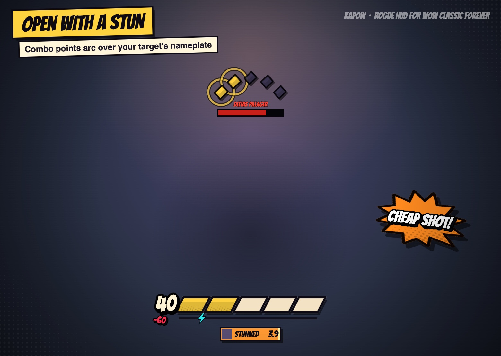
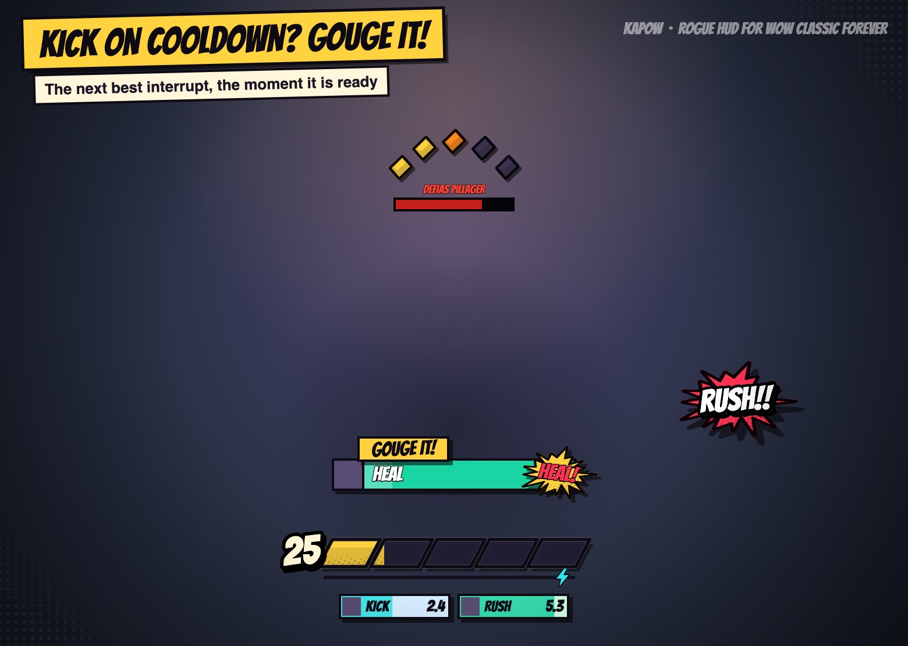
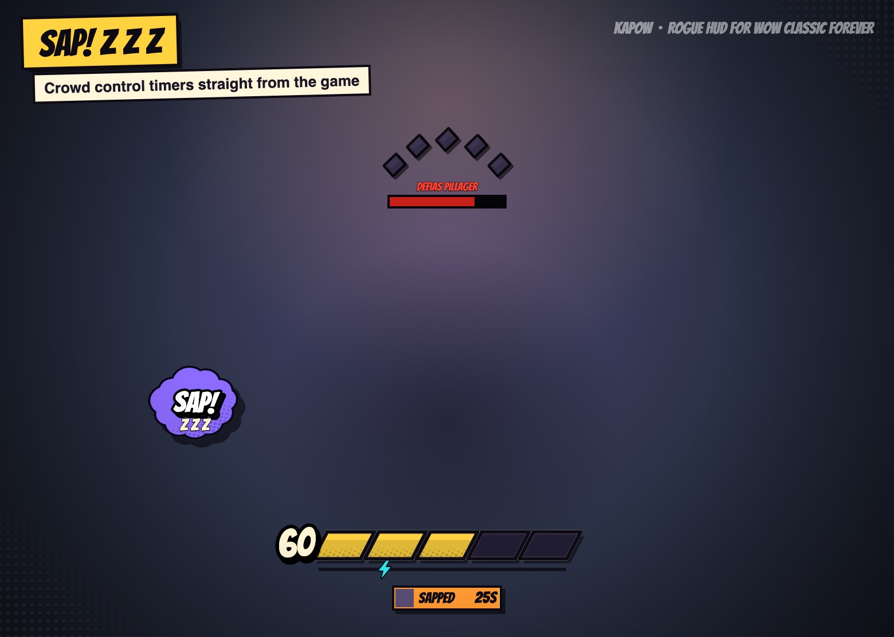

# Kapow

A comic-book HUD for rogues in **WoW Classic Forever**. Energy cells, combo pips, and a POW!
for everything you do.

| | |
|---|---|
|  |  |
|  |  |
|  | |

Rendered from the addon's own layout code (`node tools/test.js --showcase`), not in-game
screenshots; the grey square in the cast bar is where the spell's icon goes.

- **Energy** – five slanted cells and a big number. Spent energy lingers as a pale chunk before
  it drains. Regeneration is kept quiet: the number moves in calm steps and a tick only gives a
  soft flash. A bolt runs along the line under the cells, from left to right every two seconds,
  arriving as the next energy tick lands (it hides if energy trickles in instead of ticking).
  Not enough energy shakes the HUD red.
- **Combo points** – an arc of diamond pips above your target's nameplate. They pop in one by
  one, throb at five (`MAX!`), and burst when you spend them. If the target has no nameplate
  (nameplates off, or hidden from addons), the pips show on the HUD instead.
- **Ability bursts** – `SLASH!`, `STAB!`, `AMBUSH!`, `GOUGE!`, `KICK!`, `SAP! z z z`, `POOF!`…
  Finishers grow with the points spent (`EVISCERATE! 5 POINTS`). Each burst holds still for
  about a second in a fixed spot a little above the HUD: what you cast on the left, what
  happened (`CRIT!`, `DODGED!`, `DENIED!`, `K.O.!`) on the right. A new word replaces the old one
  on its side, so they never pile up, and nothing covers the middle of the screen or the unit
  frames.
- **Hits** (solo only) – `CRIT!` with the number, `DODGED!`, `PARRIED!`, `MISS!`, and `K.O.!`
  when the target drops.
- **Kick** – `KICK IT!` flashes while your target is casting something you can kick. With Kick
  on cooldown it suggests `GOUGE IT!` or `KIDNEY SHOT!` instead, and if none of them is ready it
  stays up, dimmed, counting down (`KICK IN 3`) so you still see what is coming. The box is a comic cast bar: a caption tab says what to do, and the bar shows the
  spell's icon and name and fills as the cast goes on; it turns green
  with a `HEAL!` tag when the spell is a heal (`BUFF!` for other helpful spells). `DENIED!` when
  your Kick, Gouge or stun breaks the cast.
- **Countdown boxes** – Sap, Gouge, Blind and stuns on the target, Slice and Dice, Rupture,
  Sprint, Evasion and friends on you, and short cooldowns (`KICK 7.2`, then `KICK READY!`).
  A parry puts up a `RIPOSTE!` box.
- Turns purple while you are stealthed. Only shown in combat: it pops up on a pull and fades
  out two seconds after combat ends.

## Install

Copy the `Kapow` folder into `World of Warcraft/_forever_/Interface/AddOns/` and restart the
game. It only runs on rogues.

## Options

**Options > AddOns > Kapow** has the settings: lock and size the HUD, idle opacity, the tick
timer, where combo points show and how high the arc sits, the word bursts and their size,
`CRIT!`/`DODGED!`, the `KICK IT!` cast bar, and buttons to play the demo or reset the position.
`/kapow options` opens it.

## Commands

| | |
|---|---|
| `/kapow test` | play a 15-second pretend fight, to see every effect |
| `/kapow unlock` / `lock` | drag the HUD somewhere else |
| `/kapow scale 1.2` | resize (0.5 – 2.5) |
| `/kapow idle 0.35` | opacity out of combat (default 0: hidden) |
| `/kapow fx 0.8` | size of the word bursts (0.5 – 1.5) |
| `/kapow pips plate` / `hud` / `both` | where combo points show |
| `/kapow arc 10` | how high the arc sits above the nameplate |
| `/kapow ticker` | toggle the energy tick timer under the cells |
| `/kapow words` | toggle the ability bursts |
| `/kapow hits` | toggle `CRIT!` / `DODGED!` |
| `/kapow prompt` | toggle `KICK IT!` |
| `/kapow reset` | default position and size |

## Credits

Lettering is [Bangers](https://github.com/googlefonts/bangers) by Vernon Adams, under the SIL
Open Font License (`Kapow/Fonts/OFL.txt`). If the font cannot be loaded, the game's
damage-number font is used instead.

## Development

- `python3 tools/gen_art.py` redraws the textures in `Kapow/Art` (pure Python).
- `node tools/test.js` runs the addon's Lua against a mock of the game built from Blizzard's
  generated API docs (it checks every widget method, global and event the addon uses exists in
  the client, and replays a fight with energy readable and with energy secret). It needs a
  folder of those docs and `fengari-web.js`; pass `--docs` and `--fengari` if they are not where
  it looks. `--snap out.html` also paints what the HUD looks like at moments of the demo.
- The README images: `node tools/test.js --showcase /tmp/show/index.html`, then
  `python3 tools/showcase_save.py /tmp/show` and open `http://localhost:8767/index.html?save`;
  each image is written to `docs/screens` (as JPEG where macOS `sips` is available).
